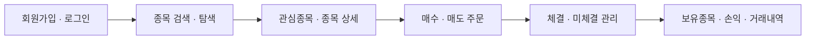
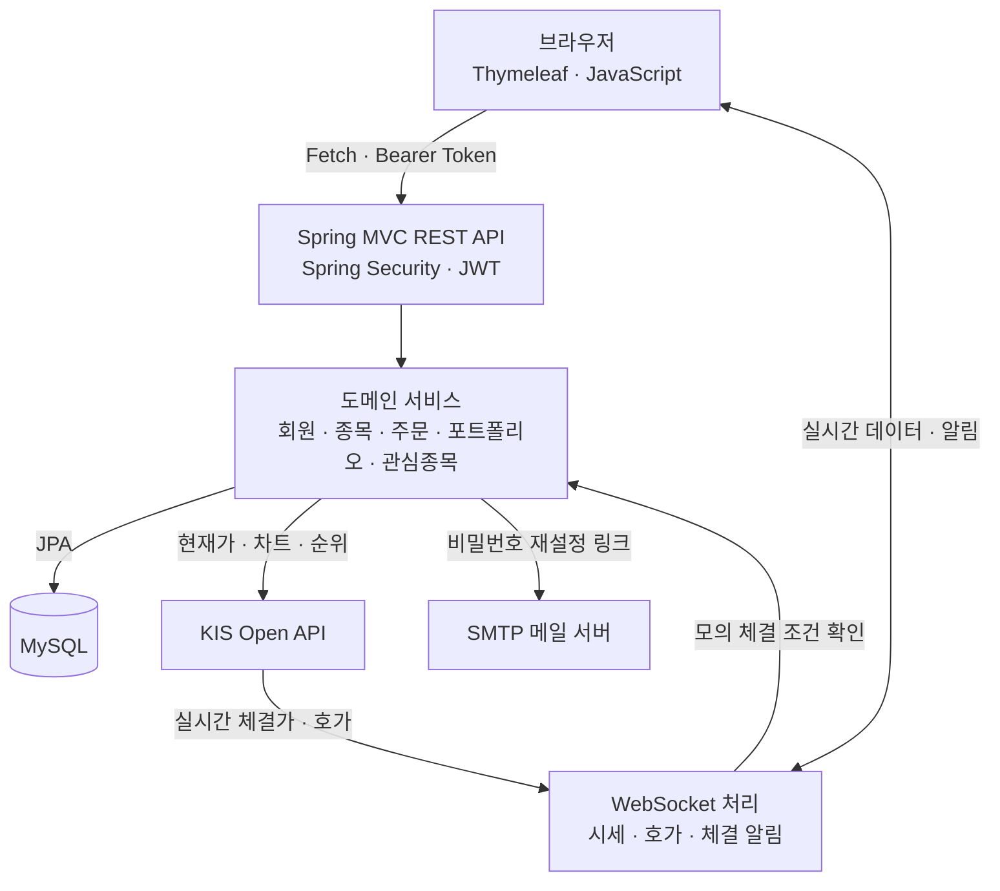

<div align="center">

# 📈 StockVault

**실제 시장 데이터로 경험하는 나만의 모의투자 플랫폼**

종목 탐색부터 관심종목, 실시간 차트·호가, 주문과 자산 관리까지


[주요 기능](#-주요-기능) · [서비스 구조](#-서비스-구조) · [로컬 실행](#-로컬-실행) · [테스트](#-테스트) · [앞으로의 계획](#-앞으로의-계획)

</div>

---

## 💡 프로젝트 소개

StockVault는 **한국투자증권 KIS Open API의 시장 데이터와 가상 자산을 연결한 국내 주식 모의투자 웹 애플리케이션**입니다.

사용자는 가입 시 지급되는 **가상 현금 1,000만 원**으로 종목을 탐색하고, 매수·매도 주문을 접수하며, 보유종목과 손익을 확인할 수 있습니다. 시세 조회에 그치지 않고 **주문 → 예약 자산 → 체결 → 보유종목 → 거래내역**으로 이어지는 흐름을 구현하는 데 초점을 맞췄습니다.

> **시장 데이터는 KIS에서 받아오며, 주문과 체결은 애플리케이션 내부에서 모의 처리합니다.** 실제 증권 계좌에 매수·매도 주문을 전송하지 않습니다.

## 🖥️ 화면 구성

| 화면 | 주요 내용 |
| --- | --- |
| **관심종목** | 종목 검색, 관심종목 추가·삭제·정렬, 선택 종목의 차트와 시세 |
| **내 주식** | 자산현황, 보유종목, 미체결 주문, 거래내역 |
| **탐색** | KRX 당일 누적 거래량 상위 30개 종목, 관심종목 하트, 상세페이지 이동 |
| **종목 상세** | 실시간 현재가, 기간별 차트, 호가, 해당 종목의 보유·주문·거래 정보 |
| **계정 관리** | 회원가입·로그인, 닉네임·비밀번호 변경, 이메일 비밀번호 재설정 |

### 서비스 이용 흐름



## ✨ 주요 기능

| 영역 | 구현 내용 |
| --- | --- |
| **인증** | Spring Security + JWT 인증, BCrypt 비밀번호 암호화, 토큰 연장, 인증 버전 검증 |
| **계정** | 이메일·닉네임 중복 검사, 내정보 수정, 일회용 링크를 통한 비밀번호 재설정 |
| **종목** | 종목명·종목코드 검색, KOSPI·KOSDAQ MST 마스터 가져오기, 종목 상세 조회 |
| **관심종목** | 사용자별 추가·삭제, 드래그 정렬, 종목코드를 이용한 상세 이동 |
| **탐색** | 거래량 상위 1~30위, 가격·등락률·거래량 표시, 하트로 관심종목 추가·해제 |
| **시세·차트** | KIS 현재가·가격 이력 조회, WebSocket 시세 수신, `1D / 1W / 1M / 1Y` 차트 |
| **호가** | 매수·매도 호가와 잔량 조회, 실시간 호가 갱신 |
| **주문** | 매수·매도 접수, 현금·보유수량 검증 및 예약, 미체결 수정·취소, 부분체결 |
| **포트폴리오** | 보유 현금·예약 현금·주문 가능 금액, 평가금액, 손익·수익률 조회 |
| **알림·운영** | 사용자별 WebSocket 체결 알림, 요청 추적 ID, 감사 로그, 요청 횟수 제한, 상태 확인 API |

### 탐색 탭의 갱신 방식

- 전체 시장 순위는 **KIS 거래량 순위 REST API**로 조회합니다.
- 서버가 **60초 동안 조회 결과를 공유**해 여러 사용자의 반복 요청을 줄입니다.
- 브라우저는 탐색 화면이 보일 때만 주기적으로 조회하며, 동일한 목록은 다시 그리지 않습니다.
- 조회 실패 시 마지막 결과와 갱신 지연 안내를 표시합니다. 첫 조회부터 실패한 경우에는 오류 안내를 표시합니다.
- 6자리 주식·ETF 코드와 `Q` 접두어를 가진 7자리 ETN 코드를 처리합니다.
- DB에 없는 종목을 선택하면 서버 순위와 KIS 기본정보를 확인해 등록한 뒤 관심종목·상세페이지로 연결합니다.

## 🧩 서비스 구조



### 설계에서 다룬 부분

| 주제 | 구현 방식 |
| --- | --- |
| **계층 분리** | Controller → Service → Repository 구조를 사용하고 API 응답은 DTO로 전달 |
| **인증과 사용자 구분** | Bearer JWT로 요청을 검증하고 로그인 사용자를 기준으로 자산·주문·관심종목 조회 |
| **외부 데이터 분리** | 현재가·차트·호가 Provider를 분리해 KIS 연동 코드와 도메인 로직 구분 |
| **주문과 자산 연결** | 주문 접수 시 현금 또는 수량을 예약하고 체결·수정·취소 결과를 자산에 반영 |
| **실시간 구독** | 화면에서 보는 종목과 미체결 주문 종목을 구독 대상으로 관리 |
| **조회 비용 관리** | 탐색 순위 캐시와 실패 후 재시도로 외부 API 반복 호출 완화 |

### 모의 체결의 범위

현재 체결 로직은 **주문 가격 조건과 실시간 체결가**, **호가 잔량에 따른 부분체결**을 사용합니다. 체결가 기반 경로에서는 가격 조건을 충족하면 남은 수량 전체를 체결할 수 있습니다.

실제 거래소의 개별 주문 대기순번이나 시장 충격을 재현하는 매칭 엔진은 아니며, **실제 체결량만큼 대기 물량을 소비하는 정밀 모델은 향후 개선 대상**입니다.

## 🛠️ 기술 스택

| 구분 | 기술 |
| --- | --- |
| Language | Java 21 |
| Backend | Spring Boot 4.0.6, Spring MVC, Spring Security, Spring Data JPA |
| Authentication | JWT, BCrypt |
| Database | MySQL |
| Frontend | Thymeleaf, HTML, CSS, JavaScript, Fetch API |
| Realtime | Spring WebSocket, KIS WebSocket |
| External API | 한국투자증권 KIS Open API |
| Mail / Monitoring | Spring Mail, Spring Boot Actuator |
| Build / Test | Gradle Wrapper 9.4.1, JUnit 5, Mockito, Spring Test, Node.js 테스트 러너 |

## 🚀 로컬 실행

### 1. 준비 사항

- JDK **21**
- 실행 가능한 MySQL 서버와 사용할 데이터베이스
- KIS API App Key·App Secret 및 REST·WebSocket 접속 주소
- 실제 메일 발송을 사용할 경우 SMTP 접속 정보
- Node.js는 화면 스크립트 테스트를 실행할 때만 필요합니다.

### 2. 프로젝트 가져오기

```powershell
git clone https://github.com/dohyun1423/MockStock-Trading_StockVault.git
cd MockStock-Trading_StockVault
```

MySQL에 기본 설정에서 사용하는 데이터베이스를 생성합니다.

```sql
CREATE DATABASE mockstock CHARACTER SET utf8mb4;
```

### 3. 로컬 설정 파일 작성

프로젝트 루트에 `config/application-secret.yml`을 만듭니다. `application.yml`에서 `secret` 프로필을 포함하므로 별도 프로필 지정 없이 읽습니다.

<details>
<summary><strong>application-secret.yml 작성 예시</strong></summary>

아래 값은 모두 예시입니다. 본인의 접속 정보로 바꿔 사용합니다.

```yaml
spring:
  datasource:
    url: jdbc:mysql://localhost:3306/mockstock?serverTimezone=Asia/Seoul
    username: YOUR_DB_USERNAME
    password: "YOUR_DB_PASSWORD"
  mail:
    host: YOUR_SMTP_HOST
    port: 587
    username: YOUR_SMTP_USERNAME
    password: "YOUR_SMTP_PASSWORD"
    properties:
      mail:
        smtp:
          auth: true
          starttls:
            enable: true

jwt:
  secret: "REPLACE_WITH_YOUR_OWN_RANDOM_SECRET_AT_LEAST_32_BYTES"

kis:
  provider: kis
  base-url: YOUR_KIS_REST_BASE_URL
  websocket-url: YOUR_KIS_WEBSOCKET_URL
  app-key: YOUR_KIS_APP_KEY
  app-secret: "YOUR_KIS_APP_SECRET"

app:
  password-reset-url: http://localhost:8080/reset-password
  websocket:
    allowed-origins: http://localhost:8080,http://127.0.0.1:8080
```

JWT 비밀키는 최소 32바이트의 임의 값으로 설정합니다. SMTP 포트·인증·TLS 설정은 사용하는 메일 서비스에 맞춥니다.

이 파일은 `.gitignore`에 등록되어 있습니다. 실제 비밀번호·JWT 비밀키·API 키를 README나 소스 코드에 넣지 않습니다.

</details>

### 4. 서버 실행

Windows PowerShell:

```powershell
.\gradlew.bat bootRun
```

macOS / Linux:

```bash
bash ./gradlew bootRun
```

실행 후 [http://localhost:8080](http://localhost:8080)에 접속해 회원가입·로그인을 진행합니다.

### 5. 종목 데이터 준비

KOSPI·KOSDAQ 마스터 파일은 `src/main/resources/stock-master/`에 포함되어 있으며, **관리자 API를 호출할 때 DB에 반영**됩니다.

```http
POST /api/admin/stocks/master/import
Authorization: Bearer <ADMIN_ACCESS_TOKEN>
```

일반 회원가입 계정은 `USER` 권한이며, 이 API는 `ADMIN` 권한이 필요합니다. 마스터 파일은 저장소에 포함된 시점의 자료이므로 최신 종목 구성이 필요하면 파일도 갱신해야 합니다.

개발 환경의 `data.sql`에는 초기 화면용 예시 종목 데이터가 있습니다. 해당 가격과 거래량은 실시간 데이터가 아니며, 실제 시세는 KIS 조회·구독으로 받아옵니다. 탐색에서 선택한 미등록 종목은 KIS 확인 후 개별 등록됩니다.

## 🔌 주요 API

로그인·회원가입·비밀번호 재설정 요청을 제외한 아래 도메인 API는 JWT 인증이 필요합니다. 관리자 API는 추가 권한을 검증합니다.

<details>
<summary><strong>API 목록 펼치기</strong></summary>

| 영역 | Method | Endpoint | 설명 |
| --- | --- | --- | --- |
| 회원 | POST | `/api/users/signup` | 회원가입 |
| 인증 | POST | `/api/users/login` | 로그인 및 JWT 발급 |
| 회원 | GET | `/api/users/me` | 내정보 조회 |
| 계정 복구 | POST | `/api/users/password-reset/request` | 재설정 메일 요청 |
| 계정 복구 | POST | `/api/users/password-reset/confirm` | 새 비밀번호 설정 |
| 종목 | GET | `/api/stocks/search?keyword=삼성` | 종목 검색 |
| 종목 | GET | `/api/stocks/symbol/{symbol}` | 종목 상세 |
| 시세 | GET | `/api/stocks/{symbol}/quote` | 현재가 |
| 차트 | GET | `/api/stocks/{symbol}/prices?period=1D` | 기간별 가격 이력 |
| 호가 | GET | `/api/stocks/{symbol}/orderbook` | 호가 및 잔량 |
| 탐색 | GET | `/api/stocks/rankings/volume` | 거래량 순위 |
| 탐색 | POST | `/api/stocks/rankings/volume/{symbol}/resolve` | 탐색 종목 정보 확인·등록 |
| 관심종목 | GET / POST / DELETE | `/api/watchlists` | 조회·추가·삭제 |
| 관심종목 | PATCH | `/api/watchlists/order` | 정렬 순서 변경 |
| 거래 세션 | GET | `/api/orders/session` | 현재 거래 세션 안내 |
| 주문 | POST | `/api/orders/buy` · `/api/orders/sell` | 매수·매도 접수 |
| 주문 | GET | `/api/orders/open` | 미체결 주문 |
| 주문 | PATCH | `/api/orders/{orderId}` | 주문 수정 |
| 주문 | PATCH | `/api/orders/{orderId}/cancel` | 주문 취소 |
| 자산 | GET | `/api/portfolio` | 포트폴리오 |
| 거래 | GET | `/api/trades` | 거래내역 |
| 관리자 | POST | `/api/admin/stocks/master/import` | 종목 마스터 가져오기 |
| 상태 | GET | `/actuator/health` | 공개 상태 확인 |

WebSocket 접속 경로는 `/ws/stocks`와 `/ws/orders`이며, 연결 후 구독 메시지의 JWT를 검증합니다. HTTPS 접속 시 브라우저는 `wss`를 사용합니다.

</details>

## 🧪 테스트

| 영역 | 검증 내용 |
| --- | --- |
| 인증·회원 | JWT 검증, 로그인 실패 제한, 비밀번호 재설정, 회원 정보 변경 |
| 주문 | 주문 상태, 예약 자산, 수정·취소, 체결·부분체결 |
| 실시간 | 체결가·호가 메시지 파싱, 스냅샷, 구독 관리, 브로드캐스트 |
| 탐색 | 상위 30개 정렬, 동시 요청 캐시, 재시도, 실패 후 기존 결과 유지, ETN 코드 처리 |
| 종목 연결 | 미등록 탐색 종목의 KIS 정보 검증, 중복 등록 충돌 처리 |
| 화면 동작 | 하트 추가·해제·중복 클릭 방지, 상세 링크, 새 탭 진입, 숨긴 탭 갱신 중지 |

MySQL을 사용하는 애플리케이션 컨텍스트 테스트를 제외하고 단위 테스트를 실행하려면:

```powershell
.\gradlew.bat test --tests "com.stock.mockstock.domain.*" --tests "com.stock.mockstock.global.*"
```

탐색 화면 스크립트 테스트:

```powershell
node --test scripts/explore-regression.test.cjs
```

전체 테스트에는 MySQL 연결 및 스키마 초기화가 포함됩니다. 테스트용 DB를 설정한 뒤 실행합니다.

```powershell
.\gradlew.bat test
```

자동 테스트와 별개로 KIS 장중 시세·호가 수신, 실제 SMTP 발송, 배포 환경의 WebSocket 연결은 연동 환경에서 확인해야 합니다.

## 📦 배포 설정

현재 공개 배포 주소는 문서에 등록하지 않았습니다. 저장소에는 환경변수 기반의 `application-prod.yml`이 준비되어 있습니다.

```powershell
.\gradlew.bat bootJar
```

생성된 JAR을 서버에서 실행합니다.

```bash
java -jar build/libs/mockstock-0.0.1-SNAPSHOT.jar --spring.profiles.active=prod
```

<details>
<summary><strong>prod 프로필 환경변수</strong></summary>

| 변수 | 용도 |
| --- | --- |
| `SPRING_DATASOURCE_URL` | 서버 MySQL의 JDBC 접속 주소 |
| `SPRING_DATASOURCE_USERNAME` / `SPRING_DATASOURCE_PASSWORD` | DB 인증정보 |
| `JWT_SECRET` | JWT 서명용 비밀키 |
| `KIS_BASE_URL` / `KIS_WEBSOCKET_URL` | KIS REST·WebSocket 주소 |
| `KIS_APP_KEY` / `KIS_APP_SECRET` | KIS 인증정보 |
| `MAIL_HOST` / `MAIL_PORT` | SMTP 접속 주소·포트 |
| `MAIL_USERNAME` / `MAIL_PASSWORD` | SMTP 인증정보 |
| `PASSWORD_RESET_URL` | 공개 주소 기준 비밀번호 재설정 URL |
| `WEBSOCKET_ALLOWED_ORIGINS` | 브라우저가 접속하는 공개 Origin |
| `PORT` | HTTP 포트, 기본값 `8080` |

배포 환경에서는 로컬의 `application-secret.yml`을 포함하지 않고 위 환경변수로 설정합니다. 새 DB에는 별도로 종목 데이터와 시연 계정을 준비합니다. 메일 기능에는 사용하는 호스팅 환경의 SMTP 통신 지원도 필요합니다.

</details>

## 🗂️ 디렉터리 구성

```text
src/main
├── java/com/stock/mockstock
│   ├── domain
│   │   ├── user          # 회원 · 인증 · 비밀번호 재설정
│   │   ├── stock         # 종목 · KIS Provider · 실시간 · 탐색
│   │   ├── order         # 주문 · 체결 · 거래내역
│   │   ├── portfolio     # 보유종목 · 자산
│   │   └── watchlist     # 관심종목
│   ├── global            # 보안 · 설정 · 예외 · 감사 로그
│   └── web/controller    # 화면 라우팅
└── resources
    ├── templates         # Thymeleaf 화면
    ├── static/css        # 화면 스타일
    ├── static/js         # API 호출 · 화면 상태 · WebSocket
    └── stock-master      # KOSPI · KOSDAQ 마스터
```

## 🧭 앞으로의 계획

- [ ] 실제 거래량과 주문 대기 물량을 고려한 모의 체결 모델 개선
- [ ] 거래 캘린더와 실시간 연결·복구 시나리오 검증 확대
- [ ] 시장 데이터·뉴스·외부 정보를 학습과 분석에 활용할 수 있는 저장 구조 설계
- [ ] 투자 전략 분석과 매수·매도 의사결정을 수행하는 AI 모델 연결

AI 매매 모델은 현재 구현 범위에 포함되지 않습니다. 우선 모의투자 서비스의 기본 흐름과 외부 데이터 연동을 정리한 뒤 단계적으로 확장할 예정입니다.

---

<div align="center">

**StockVault · 실제 시장을 관찰하고, 가상 자산으로 거래 흐름을 경험합니다.**

</div>
